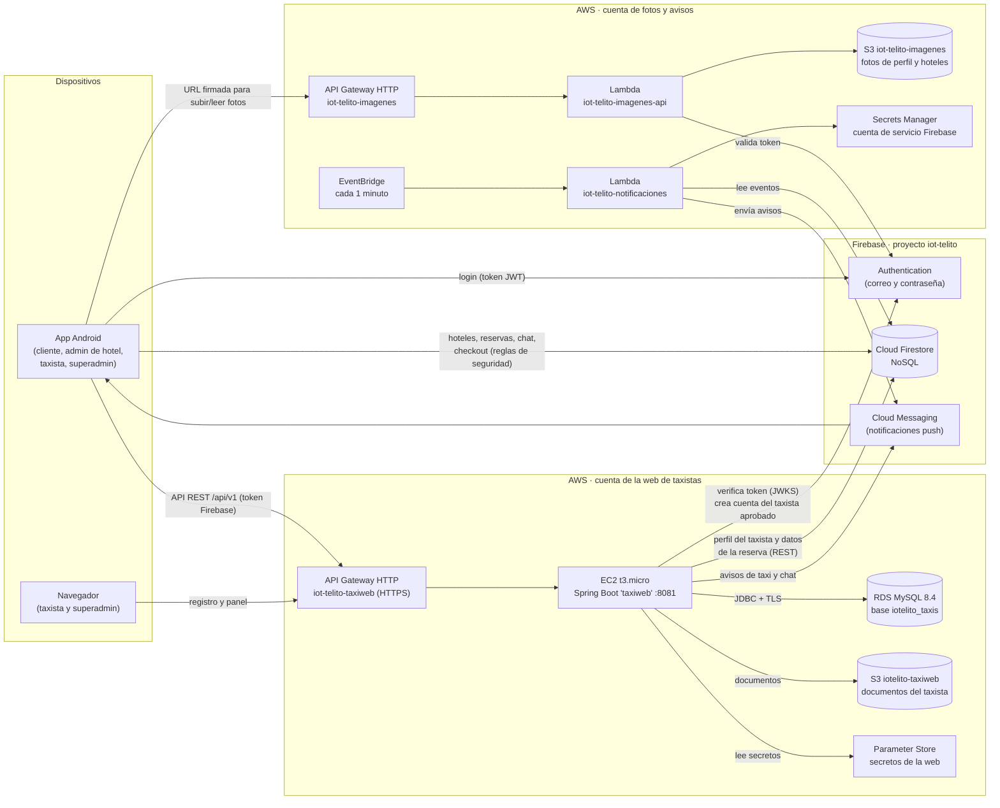
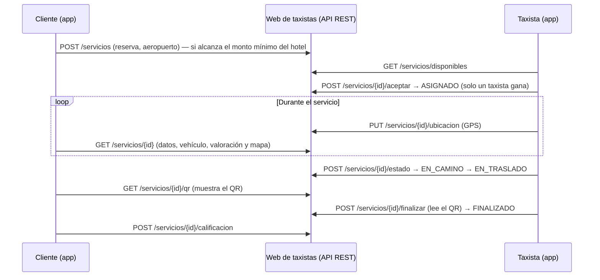

# Arquitectura del sistema — IoTelito

Sistema para la gestión de reservas de alojamiento en hoteles vía aplicación móvil
(1TEL05 – Servicios y Aplicaciones para IoT, 2026-2).

Según el *Plan de proyecto*, el sistema tiene **dos aplicaciones**:

1. **Aplicación móvil principal** (Android nativo, Java, API 34+): la usan el superadmin, los
   clientes, los administradores de hotel y los taxistas. Cada rol ve sus propias pantallas.
2. **Aplicación web de gestión de taxistas** (Spring Boot + MySQL): autoregistro de taxistas,
   aprobación por el superadmin y una **API REST** que la app móvil consume para todo lo de taxis.

## Diagrama general

## Componentes

| Componente | Tecnología | Responsabilidad |
|---|---|---|
| App móvil | Android nativo, Java, minSdk 34, View Binding, Navigation, RecyclerView, OSMDroid (mapas), ZXing / ML Kit (QR) | Interfaz de los 4 roles. Habla con Firebase, con la API de fotos y con la API REST de taxis. |
| Firebase Authentication | Correo y contraseña | Identidad de todos los usuarios. La web de taxistas también acepta estos tokens. |
| Cloud Firestore | NoSQL de documentos | Persistencia de la app principal: usuarios, hoteles, habitaciones, servicios, reservas, chat cliente–hotel, comprobantes, logs. Protegido por `firestore.rules`. |
| Firebase Cloud Messaging | Push | Avisos de checkout, cobro y taxi al celular. |
| API de fotos | API Gateway HTTP + Lambda Node.js + S3 | Entrega URLs firmadas para subir y ver fotos de perfil y de hoteles, solo al dueño o al admin del hotel. |
| Emisor de avisos | EventBridge (cada minuto) + Lambda Node.js + Secrets Manager | Revisa cambios en reservas y comprobantes y envía la notificación push una sola vez. |
| Web de gestión de taxistas | Spring Boot 3.5, Thymeleaf, Spring Security, JPA | Autoregistro del taxista con documentos, panel del superadmin (aprobar, rechazar, buscar), logs, y API REST para la app. |
| Base de la web | Amazon RDS MySQL 8.4 (`iotelito_taxis`) | Taxistas, documentos, pedidos, servicios de taxi, ubicaciones, calificaciones, chat de taxi, logs. |
| Documentos del taxista | Amazon S3 privado | Fotos y documentos subidos al registrarse; el panel los muestra con URLs firmadas de 5 minutos. |
| Entrada HTTPS | Amazon API Gateway (HTTP API) | Da HTTPS a la web (que corre en HTTP en la EC2) para que Android la pueda usar. |

## Integración app ↔ web de taxistas (API REST)

Contrato completo: [`docs/api-taxis-v1.yaml`](../api-taxis-v1.yaml) (OpenAPI 3, 20 operaciones).
Base: `https://bkmx72ue4k.execute-api.us-east-1.amazonaws.com/api/v1`.

| Grupo | Operaciones |
|---|---|
| Públicas | `GET /health`, `GET /aeropuertos` |
| Taxista | `GET /taxistas/me`, `PUT /taxistas/me/disponibilidad`, `GET /taxistas/me/servicio-activo`, `GET /taxistas/me/servicios`, `GET /servicios/disponibles`, `POST /servicios/{id}/aceptar`, `POST /servicios/{id}/estado`, `PUT /servicios/{id}/ubicacion`, `POST /servicios/{id}/finalizar` (con el QR) |
| Cliente | `POST /servicios` (pedir taxi), `GET /servicios/{id}`, `GET /servicios/{id}/qr`, `POST /servicios/{id}/calificacion` |
| Ambos | `GET/POST /servicios/{id}/mensajes` (chat del viaje), `PUT /notificaciones/dispositivo` |
| Superadmin | `GET /taxistas`, `PATCH /taxistas/{id}/activo` |

Así se cumple la restricción del enunciado: **la app nunca accede a la base MySQL**; toda
consulta o actualización de taxistas pasa por esta API. Las reglas de Firestore niegan las
colecciones antiguas de taxi (`taxistas`, `taxiRequests`, `taxiDrivers`).

## Flujos principales

### Reserva y checkout
1. El cliente busca hoteles y reserva con una tarjeta simulada. Firestore bloquea las noches
   (`roomNights` por habitación y `clientNights` por cliente) dentro de una transacción, así
   no hay dos reservas de la misma habitación ni dos estadías del mismo cliente que se crucen.
2. Desde el día de salida, el cliente pide el checkout con valoración y observaciones (`EN_CHECKOUT`).
3. El admin del hotel recibe la alerta, marca los servicios consumidos y, si hubo daños, un cargo
   adicional con monto, motivo y observación. Se crea `hotelCheckouts/{reserva}` y la reserva
   pasa a `FINALIZADA` en la misma transacción.
4. El emisor de avisos detecta el comprobante y envía la notificación de cobro al cliente.

### Taxi gratuito al aeropuerto

### Alta de un taxista
1. El taxista se registra en la web con sus datos, vehículo y documentos (a S3).
2. El superadmin revisa las miniaturas y aprueba. La web crea su cuenta en Firebase Auth, su perfil
   `users/{uid}` con rol `TAXISTA` y envía el correo para elegir contraseña.
3. El taxista entra a la app con esa cuenta.

## Seguridad

| Requisito del enunciado | Cómo se cumple |
|---|---|
| Contraseñas no en texto plano | Firebase Authentication para la app; BCrypt para el superadmin de la web. |
| Operaciones según el rol | Reglas de Firestore por rol, hotel asignado y dueño del dato. En la web, Spring Security (panel con sesión y CSRF) y la API valida el token de Firebase (emisor, audiencia y firma con las llaves públicas de Google). |
| Cliente solo ve lo suyo | Reglas por `clientUid`; la API valida que la reserva sea del cliente. |
| Registro de eventos | `logs` en Firestore (acciones del superadmin) y `logs_sistema` en MySQL (aprobaciones y rechazos). |
| Ubicación periódica | Servicio en primer plano del taxista que envía la ubicación cada pocos segundos durante el viaje. |
| API de taxis caída | La app muestra "El servicio de taxis no está disponible" y el resto del sistema sigue funcionando. |
| Secretos | Parameter Store y Secrets Manager; ninguna clave en el repositorio. Archivos en S3 privados con URLs firmadas. |

## Despliegue

| Pieza | Dónde |
|---|---|
| App | APK instalable desde Android Studio (rama `feat/hotel-admin`). |
| Firebase | Proyecto `iot-telito`; reglas publicadas desde `firestore.rules`. |
| API de fotos y emisor de avisos | Cuenta AWS de laboratorio (us-east-1). |
| Web de taxistas | EC2 `servidor-proyecto-web` (servicio `taxiweb`, puerto 8081) + RDS `iotelito-db` + API Gateway `bkmx72ue4k`, en otra cuenta AWS de laboratorio. |

Detalle de instalación: [04-MANUAL-INSTALACION.md](04-MANUAL-INSTALACION.md).
Costos: [03-COSTO-OPEX.md](03-COSTO-OPEX.md). Datos: [02-BASE-DE-DATOS.md](02-BASE-DE-DATOS.md).
