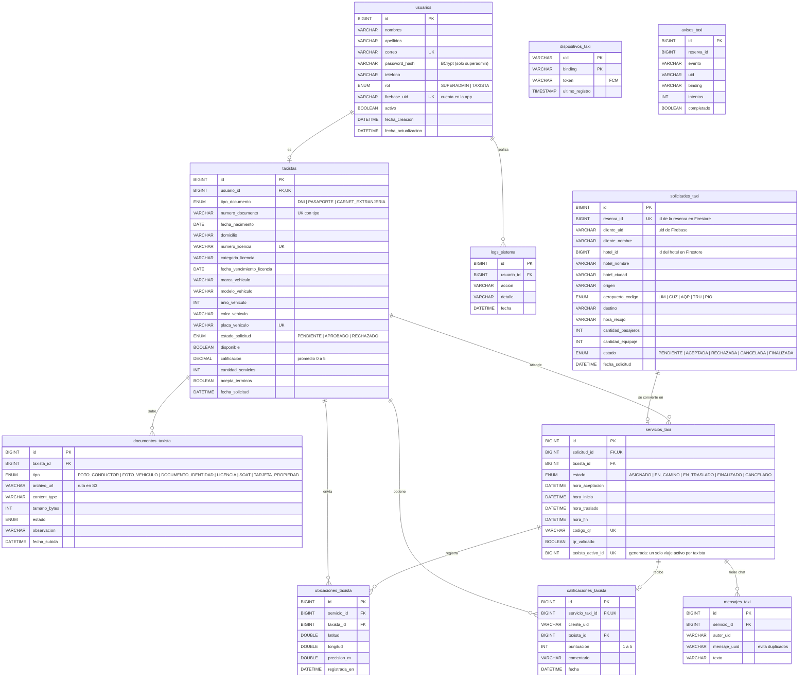
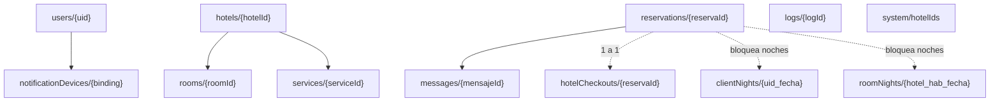

# Bases de datos — IoTelito

El sistema usa **dos bases**, como pide el enunciado:

| Base | Motor | La usa | Contenido |
|---|---|---|---|
| `iot-telito` (Firebase) | **Cloud Firestore (NoSQL)** | App móvil principal | Usuarios, hoteles, habitaciones, servicios, reservas, chat cliente–hotel, comprobantes de checkout, logs. |
| `iotelito_taxis` | **MySQL 8.4** (Amazon RDS) | Web de gestión de taxistas y su API REST | Taxistas, documentos, pedidos y servicios de taxi, ubicaciones, calificaciones, chat de taxi, logs. |

La app no se conecta a MySQL: lo de taxis lo pide a la API REST (ver [01-ARQUITECTURA.md](01-ARQUITECTURA.md)).

---

## 1. MySQL — base de la web de taxistas

**Scripts (DDL y DML)**, en la rama `feat/taxi-api-web`, carpeta `web-taxis/db/`:

| Archivo | Tipo | Qué hace |
|---|---|---|
| `00-crear-base.sql` | DDL | Crea la base. |
| `schema.sql` | DDL | Crea las 8 tablas principales con llaves, únicos y `CHECK`. |
| `01-chat-y-avisos-taxi.sql` | DDL | Agrega las 3 tablas de chat y avisos de taxi. |
| `data.sql` | DML | Datos de demostración: superadmin, 10 taxistas, documentos, pedidos, servicios, ubicaciones y calificaciones. |

La web arranca con `ddl-auto=validate`: si las entidades Java y `schema.sql` no coinciden, no inicia.

### Diagrama entidad–relación

### Reglas de integridad importantes

- **Asignación exclusiva:** `servicios_taxi.solicitud_id` es único (un pedido, un solo taxista) y
  `taxista_activo_id` (columna generada) es única, así un taxista no puede tener dos viajes activos.
- **Un taxista por persona, documento, licencia y placa:** únicos en `taxistas`.
- **Una calificación por viaje:** `calificaciones_taxista.servicio_taxi_id` único; la web recalcula
  `taxistas.calificacion` como promedio.
- **Ids de Firestore sin llave foránea:** `reserva_id`, `hotel_id` y `cliente_uid` vienen de la app;
  la API los valida leyendo Firestore con el token del usuario.

---

## 2. Cloud Firestore — base de la app principal

Documentación detallada del contrato: [`FIRESTORE_SCHEMA.md`](../../FIRESTORE_SCHEMA.md).
Reglas de seguridad: [`firestore.rules`](../../firestore.rules) (probadas en `app/src/test/js/`).

| Colección | Campos principales | Quién escribe |
|---|---|---|
| `users/{uid}` | `role` (CLIENT, HOTEL_ADMIN, TAXISTA, SUPERADMIN), `name`, `firstNames`, `lastNames`, `documentType`, `documentNumber`, `birthDate`, `email`, `phone`, `address`, `photoUrl`, `active`, `hotelId` (admin) | El cliente al registrarse (solo rol CLIENT); el superadmin activa/desactiva y asigna hotel; la web crea el de los taxistas aprobados. |
| `users/{uid}/notificationDevices/{binding}` | `token` FCM, `platform`, `updatedAt` | La app del cliente. |
| `hotels/{hotelId}` | `name`, `address`, `district`, `city`, `latitude`, `longitude`, `description`, `attractions` (lugares cercanos), `photos[]` (mín. 4), `active`, `administratorUid`, `rooms`, `pricePerNight`, `hasInventory`, `services[]` (comodidades), **`taxiMinAmount`** (monto mínimo para el taxi gratis) | Superadmin (alta, datos, asignación de admin) y admin del hotel (datos, fotos, monto del taxi). |
| `hotels/{id}/rooms/{roomId}` | `tipo`, `nombreCodigo`, `adultos`, `ninos`, `areaM2`, `precioNoche`, `descripcion`, `disponible`, `archived` | Admin del hotel. |
| `hotels/{id}/services/{serviceId}` | `nombre`, `descripcion`, `precio`, `unidad`, `activo`, `archived`, `fotoUrl` | Admin del hotel. |
| `reservations/{id}` | `clientUid`, `hotelId`, `roomIds[]`, `fechaEntrada`, `fechaSalida`, `huespedes`, `precioTotal`, `estado` (CONFIRMADA, EN_CHECKOUT, FINALIZADA…), tarjeta simulada (`cardType`, `cardLast4`, `cardToken`), `rating`, `review` | El cliente (crear y pedir checkout); el admin la finaliza. |
| `reservations/{id}/messages/{id}` | `senderUid`, `senderRole`, `text`, `createdAt` | Chat cliente–hotel mientras la reserva está activa. |
| `hotelCheckouts/{reservaId}` | `base`, **`services[]`** y **`servicesTotal`** (servicios consumidos), `extra`, `reason`, `observation` (daños), `total`, tarjeta, `createdAt`, `createdByUid` | Admin del hotel al cobrar (misma transacción que finaliza la reserva). |
| `clientNights/{uid_fecha}` / `roomNights/{hotel_hab_fecha}` | `reservationId` | La transacción de reserva: impiden reservas que se crucen. |
| `logs/{id}` | `actorUid`, `actorRole`, `action`, `entityType`, `entityId`, `createdAt` | Superadmin (lectura y escritura). |
| `system/hotelIds` | `nextId` | Contador para ids de hoteles nuevos. |
| `pushDeliveries/{id}` | Estado interno del emisor de avisos | Solo la Lambda (Admin SDK); nadie desde la app. |
